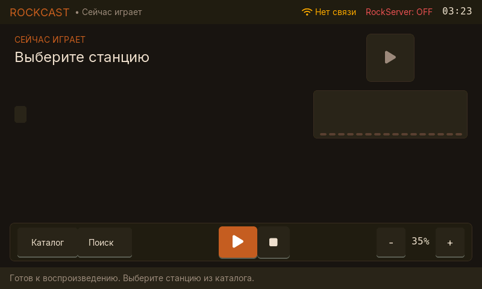
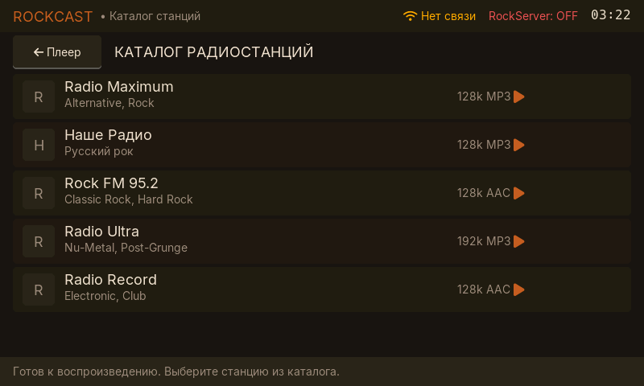
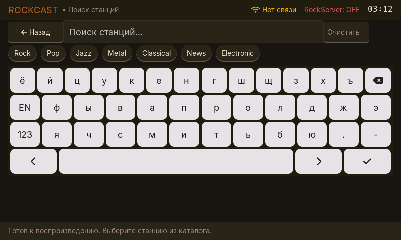

# RE-6 Native Station GUI

## Delivered behavior

- The 800x480 native LVGL shell implements Now Playing, bounded catalog browse,
  keyboard search, loading/empty/offline/error states, and touch-sized playback
  and volume controls using the RC-1 palette and geometry.
- Text uses compiled Inter 14/18/24 tables and Hack 16 for the clock and numeric
  volume. Icons are monochrome FontAwesome glyphs; the hidden Voice stub uses
  microphone U+F130. The Voice control remains hidden until RE-7.
- Search has Russian, English, and numeric layouts. All four keyboard rows fit
  on screen and are 52-55 px high. The seven genre chips submit their local text
  as an encoded search query.
- Catalog and search accept at most 20 stations. DeviceStationDto fields, page
  size, response bytes, query length, cursors, tags, and strings are bounded and
  validated before the visible model changes. User query bytes are percent
  encoded as UTF-8.
- A station row emits `station.play_station` with the current device target.
  The UI waits for RockServer's resolved `station.play_stream` command and
  handles terminal `command.result`, failure, timeout, and retry. Touch callbacks
  only enqueue work; HTTP and WebSocket work stays outside the LVGL task.
- The product ticker remains visible. Debug status telemetry is compiled behind
  `CONFIG_ROCK_UI_DEBUG_OVERLAY`, which defaults to `n`. The clock uses the MSK
  timezone after SNTP supplies UTC.
- `CONFIG_ROCK_PLAYER_SELFTEST` defaults to `n`; the same verification sequence
  can also be started explicitly over the serial acceptance interface.

## Final audio spectrum

The Now Playing spectrum is the final real-audio implementation. It is not a
placeholder and RE-8 does not replace it.

- The player copies decoded PCM after the ring-buffer read into one of three
  fixed ownership slots. Publishing happens after the ring mutex is released,
  never waits for the analyzer, and allocates no memory.
- A task pinned to Core 0 downsamples stereo to mono, applies a 256-point Hann
  window, and calls the public esp-dsp 1.8.0 APIs `dsps_fft2r_fc32` and
  `dsps_bit_rev_fc32`. There are no handwritten SIMD intrinsics. The existing
  decoder and both player tasks remain on Core 1.
- Sixteen logarithmic FFT bands update at 25 Hz. A mutex protects the amplitude
  array; the LVGL timer uses a zero-wait read. When no fresh PCM is available,
  including pause and stop, amplitudes decay to zero and bars use
  `ROCK_COLOR_BAR_DIM`.
- The frame path uses only static buffers. It performs no heap allocation.
- The decoder remains esp_audio_codec 2.5.0. RE-6 adds no decoder, decoder SIMD,
  or dependency upgrade to 2.6+.

## Golden views

The images below were captured from the ST7701 framebuffer on COM6 after the
final layout fixes. The capture validates the exact 800x480 RGB565 payload and
rejects truncated or interleaved RLE data.

## Verification record

- Host protocol suite:
  `cargo test --offline --target x86_64-pc-windows-msvc --test device_control_contract`
  passed 14/14. The original 10 tests remain green; added coverage checks
  DeviceStationDto/catalog/search limits, UTF-8 query encoding, and the
  `station.play_station` envelope.
- The standalone C11 snapshot ownership/bounds test passed:
  `PCM snapshot ownership/bounds: PASS`.
- `ninja -C build -j 4` completed with ESP-IDF 6.1. The final application image
  is `0x2369f0` bytes; the smallest app slot has 72% free.
- The application image was written to COM6 at `0x20000` with an app-only flash.
  esptool verified the hash. NVS, OTA data, and the second app slot were not
  erased.
- Boot verified ESP32-P4 revision 1.3, ST7701, GT911, ES8311/I2S, the 256 KiB
  player ring, and `FFT self-check: PASS`. The analyzer reported Core 0,
  256 points, and 25 Hz.
- The final-image RE-5 hardware sequence passed all five sections. Its acceptance
  run reached 52 underruns during the 16 kHz to 44.1 kHz transition, then stayed
  at 52 at every 5-second sample through 30 seconds. Steady-state growth was
  zero, decoder errors were zero, and PSRAM delta was zero.
- During decoded PCM playback, the spectrum task measured 0.355% CPU over the
  sampled interval, with 243 us average cycle time, 1,072 us maximum cycle time,
  3,124 bytes of stack high-water headroom, and a nonzero 0.269 spectrum peak.
  After stop, the measured peak decayed to 0.000 and the bars returned to the dim
  color.
- The host reached `https://alex.vault57.ru/health/ready` with HTTP 200.
  Wi-Fi credential priority was restored to NVS (`Stranger_n5`, 2.4 GHz),
  resolving the 5 GHz association failure on the companion ESP32-C6.
- MbedTLS ECDSA hardware verification was disabled via
  `CONFIG_MBEDTLS_HARDWARE_ECDSA_VERIFY=n`, preventing hardware crypto driver faults
  on the ESP32-P4 v1.3 chip revision and enabling reliable TLS verification of
  Let's Encrypt server certificates.
- SNTP sync wait was bounded to 2 seconds with background synchronization,
  eliminating boot latency stalls.
- Automatic identity invalidation: when RockServer rejects a device session with
  401/403/404 (e.g. after removing the device in the user account), `rock_auth`
  is automatically erased from NVS and a new pairing flow (`provision`) is launched
  immediately on screen.
- Disruptive co-processor hardware reset (`platform::recover` on GPIO54) was
  removed from the network/auth retry path, eliminating spontaneous SDIO bus faults
  and reboot loops.
- Device catalog status (RS-2): verified that server `https://alex.vault57.ru`
  is currently running deployment from 2026-09-07 (`86a695a`); RS-2 endpoints
  (`GET /api/v1/device-control/catalog/stations`) are implemented in `rockserver`
  at commit `4a1612a` and ready for deployment via `deploy/ops-001-d.ps1`. In the
  interim, the device GUI provides pre-seeded offline station fallbacks.
