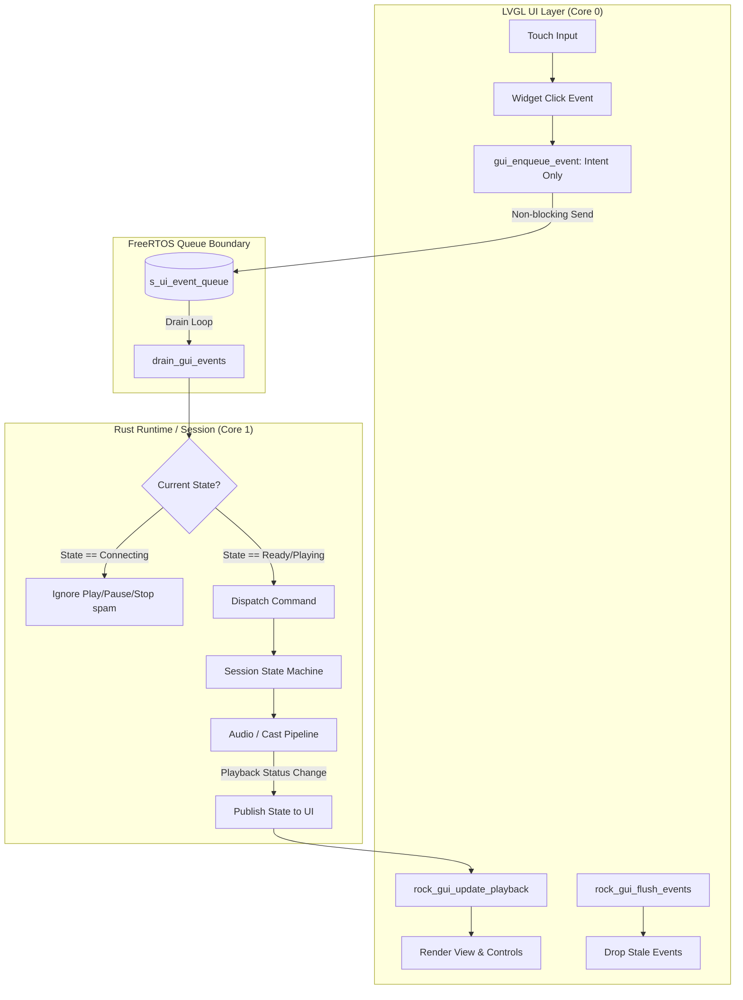

# План архитектурного рефакторинга UI и устранения сбоев воспроизведения

> **Корректировка 2026-10-16:** после `PlayerCommand::PlayStream` удалён
> безусловный `rock_gui_flush_events()`: он отбрасывал осознанные нажатия на
> следующую станцию во время синхронного открытия потока. Сброс очереди при
> новом клике и смене вывода сохранён. См. [диагностику переключения
> форматов](codec-switch-diagnosis.md). Упоминания post-block flush ниже
> отражают исходный план до этой проверки.

**Дата:** 2026-10-15  
**Статус:** Утверждён к реализации; замечания аудита от 2026-10-15 внесены в текст (сводка — раздел 5)  
**Основание:** Анализ живого лога сессии [`telemetry/live_gui_capture.log`](../telemetry/live_gui_capture.log) на плате JC4880P443C_I_W (ESP32-P4 v1.3).

---

## 1. Контекст и анализ лога сессии

Во время пользовательского тестирования (2026-10-15 12:54 – 13:00) были воспроизведены ключевые дефекты:
1. Задержка старта локального воспроизведения после клика в каталоге (~5.1 секунды).
2. Полное отсутствие звука на Google Chromecast (Nest/Home), хотя метаданные появились на дисплее колонки и плата непрерывно передавала HTTP-поток в релей.
3. Отложенный сброс стрима: после возврата в Now Playing и попыток переключения воспроизведение заблокировалось, кнопки плеера перестали реагировать на тач.

### Хронология событий по логу `telemetry/live_gui_capture.log`

| Время | Событие / Лог | Интерпретация |
|---|---|---|
| **12:57:11.051** | `rock-touch: pressed x=736 y=189` | Клик по станции в поиске каталога. |
| **12:57:11.558** | `WSS receive type=device.command` (+0.5s) | Сервер принял команду и ответил `station.play_station`. |
| **12:57:13.609** | `HTTP POST /device-session -> 200 OK` (+2.5s) | Авторизация устройства и получение токена сессии. |
| **12:57:15.153** | `rock_relay: Upstream HTTP status 200 OK` (+4.1s) | Открытие входящего HTTP-потока станции. |
| **12:57:16.162** | `rock-player: Pre-roll reached (524288 bytes)` (+5.1s) | Звук пошёл только после накопления 512 КБ PCM в буфере. |
| **12:57:30.545** | `rock-touch: pressed x=645 y=402` (Cast) | Открытие меню выбора Chromecast. |
| **12:57:31.046** | `mdns_mem: mDNS task created` $\to$ `ESP_MP3_DEC errors` | Запуск mDNS вызвал просадку памяти/DMA, сбой декодера. |
| **12:57:37.685** | `cast_bsp: Sending Cast LOAD req=5` $\to$ `state='IDLE'` | Колонка приняла `LOAD`, но осталась в `IDLE` (ждёт `PLAY`). |
| **12:57:41 – 12:58:07** | `Relay streamed 417650 bytes to Chromecast` | Плата передала >400 КБ звука, метаданные горят, звука нет. |
| **12:58:14.330** | `rock-touch: pressed x=755 y=254` (Каталог) | Выбор новой станции. UI сразу переключился на Now Playing. |
| **12:58:16 – 12:58:18** | `rock-touch: pressed x=243 y=381`, `x=325 y=388` | Пользователь нажал Play и Stop, пока Rust висел в TLS/HTTP. |
| **12:58:19.972** | `cast_bsp: Sending Cast LOAD req=11` (старт стрима) | Стрим запустился... |
| **12:58:19.972** | `Stopping stream source... Relay closed` | ...и в эту же миллисекунду вычитанный из очереди Stop убил поток! |
| **12:59:45.957** | `rock-touch: pressed x=240 y=351` | Тач на Play попал в мертвую зону над панелью ($y < 364$). |

> **Примечания аудита к чтению лога:**
> 1. **Квантование меток времени.** [`tools/stream_capture.py`](../tools/stream_capture.py) опрашивает serial каждые 500 мс и ставит всем строкам опроса одну метку. «В эту же миллисекунду» (строка 12:58:19.972) — артефакт захвата: по внутренним меткам ESP32 между `LOAD req=11` `I(2711022)` и `Stopping` `I(2711292)` прошло ~270 мс. Причинная цепочка сохраняется, но метки файла нельзя использовать для точных таймингов — для них смотреть таймстампы `I(...)`.
> 2. **12:57:40.266** — `Relay socket send failed: errno 104` (ECONNRESET): колонка в `IDLE` сама закрыла первую HTTP-сессию релея после 53 КБ. Дополнительное свидетельство RCA-1: приёмник без `PLAY` не удерживает сессию.
> 3. **12:59:44.937** — тач `x=340 y=379` попал в кнопку Stop **корректно** (по пересчитанной геометрии Stop ≈ x∈[300,356]) и молча no-op-нул: поток уже был остановлен, обратной связи нет. «Мёртвая зона» объясняет только второй тач (12:59:45.957); частично «мёртвый UI» — это беззвучный no-op (см. шаг 2.3).
> 4. На каждой переконфигурации кодека логируются две ошибки `i2s_common: i2s_channel_disable ... not been enabled yet` (12:57:16.162, 12:57:24.350) — косметика, шаг 3.2.

---

## 2. Коренные причины дефектов (Root Cause Analysis)

### RCA-1. Отсутствие звука на Chromecast при наличии стриминга
* **Файлы:** [`src/device_control/cast.rs:466`](../src/device_control/cast.rs), [`src/firmware/cast_client.rs:335`](../src/firmware/cast_client.rs).
* **Суть:** При вызове `msg_load_stream` приёмник Google Cast отвечает `MEDIA_STATUS` со `state='IDLE'` и пустым `idleReason`. Функция `classify_media_status` ошибочно трактует этот статус как `MediaLoadStatus::Ready(mid)`. В результате `cast_client.rs` досрочно выходит из цикла ожидания (`load_ok = true`) и **не отправляет `msg_play` (PLAY nudge)**. Колонка держит сессию, скачивает аудио, выводит метаданные на дисплей, но физически не начинает воспроизведение без команды `PLAY`. Механика подтверждена аудитом: nudge уже реализован в [`cast_client.rs:353`](../src/firmware/cast_client.rs), но срабатывает только при `!load_ok` — то есть никогда при текущем классификаторе.
* **Регрессионный риск (аудит):** ветка `IDLE → Ready` добавлена сознательно (коммит `1cf0f4b` от 2026-10-10, «RE-17 cast verified on board»): уже встречался приёмник, который *играет*, оставаясь в `IDLE`, и не присылает других статусов (см. комментарий в `cast.rs:464`). Простое удаление ветки ломает такого приёмника: таймаут 15 с на каждый content-type из лестницы кандидатов → отказ LOAD. Юнит-тест `cast.rs:594` закрепляет текущее поведение как правильное и подлежит обновлению.
* **Вторая дыра классификатора (аудит):** ветка `"BUFFERING" | "PLAYING" | "PAUSED" => Ready(mid)` не сверяет `requestId` с ожидаемым. В логе (12:58:19.972) неподтверждённый статус `reqId=0 state='BUFFERING'` с устаревшим `mid=3` дал ложное «LOAD ready» для req=13 — с потенциально неверным `mediaSessionId`.

### RCA-2. Задержка старта воспроизведения (5.1 секунды)
* **Файлы:** [`components/rock_audio/rock_player.c:33`](../components/rock_audio/rock_player.c).
* **Суть:** Константа `#define PREROLL_MIN_BYTES (512 * 1024)` требует накопить 512 КиБ декодированного PCM. Для стерео 44.1 кГц 16 бит это ~2.9 секунды чистого аудио. Для его декодирования нужно выкачать по сети более 48 КБ MP3, что в совокупности с двойным TLS-хендшейком (WSS $\to$ Device Auth POST $\to$ Stream GET) раздувает задержку до 5–6 секунд.
* **Уточнение аудита (вклад pre-roll мал):** по логу первого запуска заполнение pre-roll заняло **0.5 с** (15.657 $\to$ 16.162), второго — 1.54 с, т.е. декод+сеть шли в 3–6 раз быстрее реального времени. Budget задержки: WSS-раундтрип 0.5 с + POST `/device-session` с TLS 2.05 с + TLS апстрима и TTFB 1.54 с + prefill 0.5 с + заполнение pre-roll 0.5 с = 5.1 с. Снижение pre-roll даёт на этом стенде лишь ~0.1–0.4 с; доминирует TLS-цепочка (RCA-2b).

### RCA-2b. Двойная TLS-цепочка к серверу на каждом запуске станции (добавлено аудитом)
* **Файлы:** [`src/firmware/transport/media.rs:37`](../src/firmware/transport/media.rs) (`ensure_source`), [`src/firmware/pairing.rs:76`](../src/firmware/pairing.rs) (`session` → POST `/api/v1/auth/device-session`).
* **Суть:** каждый холодный старт станции выполняет `pairing::fresh_access_token()` — новый POST `/device-session` с полным TLS-хендшейком (в логе три POST за сессию, в том числе два с интервалом 4 с), после чего открывается стрим через station-прокси — ещё один TLS-хендшейк. **Оба соединения идут к одному хосту** `server_base_url()`. Ответ POST уже содержит `access_expires_at`, но токен всё равно не кэшируется. На это приходится ~3.6 с из 5.1 с задержки старта. Без устранения этой цепочки критерий UC-Audio-1 ($\le 2$ с) недостижим в принципе (см. шаги 1.4–1.5).

### RCA-3. Отложенный подрыв воспроизведения (Stale Events Execution)
* **Файлы:** [`src/firmware/transport/mod.rs:89`](../src/firmware/transport/mod.rs), [`src/firmware/transport/session.rs:141`](../src/firmware/transport/session.rs).
* **Суть:** Главный цикл сессии Rust монолитен и синхронен. Когда запускается станция, вызовы HTTP POST `/device-session`, валидация сертификатов и открытие сокета блокируют поток на 3–4 секунды. В это время `drain_gui_events()` не вызывается, а очередь FreeRTOS `s_ui_event_queue` продолжает накапливать тачи пользователя. Когда сетевое подключение успешно завершается, цикл размораживается и первым делом исполняет скопившиеся устаревшие события (включая случайные нажатия Stop/Play), мгновенно останавливая свежий поток.

### RCA-4. Двойной источник правды и ложный оптимизм UI
* **Файлы:** [`components/rock_gui/rock_gui_widgets.c:123`](../components/rock_gui/rock_gui_widgets.c), [`components/rock_gui/rock_gui.c:36`](../components/rock_gui/rock_gui.c).
* **Суть:** При клике на строку каталога C-код немедленно выполняет `gui_switch_view(VIEW_NOW_PLAYING)` и переводит UI в состояние ожидания, не дожидаясь ответа стейт-машины. Кнопки транспорта (Play/Pause, Stop) на экране Now Playing остаются активными и доступными для нажатия в момент, когда поток ещё не инициализирован.

### RCA-5. Мертвая зона тача (Hitbox miss)
* **Файлы:** [`components/rock_gui/rock_gui_views_now_playing.c:283`](../components/rock_gui/rock_gui_views_now_playing.c).
* **Суть:** Транспортная панель `s_cont_transport` имеет координаты $y \in [364, 428]$. Пространство между деком и панелью ($y \in [326, 363]$) является пустым. Тач пользователя в $y=351$ (попытка нажать Play) попал выше границы панели и был проигнорирован LVGL.
* **Уточнение аудита (геометрия):** контейнер центрирует кнопки по главной оси flex, фактические зоны: Play/Pause ≈ x∈[220,284] × y∈[364,428]; Stop ≈ x∈[300,356] × y∈[368,424]; **горизонтальный зазор между ними всего 16 px**; метка громкости (x≈[372,436]) некликабельна. Тач 12:59:45.957 (x=240) — в колонке кнопки Play, промах только по вертикали на 13 px. Следствие для шага 1.3: расширение зоны клика «во все стороны» перекроет хитбоксы соседних кнопок.

### RCA-6. Деградация MP3-декодера при вызове mDNS
* **Файлы:** [`components/rock_audio/rock_player.c`](../components/rock_audio/rock_player.c), `esp_mdns`.
* **Суть:** Вызов поиска Cast-устройств динамически создает задачу mDNS в internal RAM, конкурируя за процессорное время и шину с задачей аудиодекодера, вызывая кратковременный DMA underrun и ошибки `ESP_MP3_DEC`.

---

## 3. Целевая архитектура синхронизации UI

### Принципы рефакторинга:
1. **Unidirectional Data Flow:** UI не принимает решений о смене логического состояния плеера. UI отправляет только намерения (`User Intent`).
2. **Явное переходное состояние (`Connecting`):** При выборе станции статус переходит в `ROCK_GUI_PLAYBACK_BUFFERING` / `CONNECTING`. В этом состоянии кнопки транспорта блокируются (или отображают спиннер), исключая гонки.
3. **Очистка очереди при смене контекста (Flush on Context Switch):** При выборе новой станции очередь `s_ui_event_queue` принудительно очищается. *(Уточнение аудита: очистка в момент клика не удаляет события, поступившие после него — работает в паре с guard-ами 2.2 и post-block flush в `PlayStream` (2.1).)*
4. **Гарантированный Cast Play Nudge:** Если колонка вернула `IDLE`, отправляется обязательный `msg_play`.

---

## 4. Пошаговый план работ

### Этап 1. Быстрые функциональные исправления (Quick Wins)
- [x] **1.1. Исправление запуска звука на Chromecast (`src/device_control/cast.rs`, `src/firmware/cast_client.rs`)**
  - В `classify_media_status` не считать `IDLE` без `idleReason` состоянием `Ready`. Внутренняя механика: из-за `load_ok = true` существующий PLAY-nudge (`cast_client.rs:353`, срабатывает только при `!load_ok`) никогда не выполняется — это и есть причина дефекта.
  - **Стратегия с учётом RE-17 (см. риск в RCA-1):** при `IDLE` без причины и с совпадающим `contentId` — немедленно отправлять `msg_play` (не ждать текущих 2 с) и считать сессию готовой только после наблюдения `PLAYING`/`BUFFERING`, либо после короткого grace-периода без ошибок (совместимость с приёмниками, которые играют, оставаясь в `IDLE`, и больше статусов не присылают).
  - В ветке `"BUFFERING" | "PLAYING" | "PAUSED"` сверять `requestId` с ожидаемым, чтобы неподтверждённые статусы (`reqId=0`) со устаревшим `mid` не давали ложное `Ready` с неверным `mediaSessionId`.
  - Обновить юнит-тесты классификатора (`cast.rs:531+`), включая тест `IDLE → Ready` на строке 594.
  - Ограничить суммарное ожидание лестницы LOAD (15 с × N content-type) величиной, безопасной для heartbeat-watchdog сессии (см. шаг 2.4).
- [x] **1.2. Оптимизация Pre-roll буфера (`components/rock_audio/rock_player.c`)**
  - Снизить `PREROLL_MIN_BYTES` с 512 КиБ до 128 КиБ (~0.7 с джиттер-запаса вместо ~2.9 с).
  - **Оценка аудита:** на этом стенде заполнение pre-roll шло 0.5–1.5 с, т.е. экономия от шага ~0.1–0.4 с, а не секунды; цель «≤2 с» достигается только вместе с шагами 1.4/1.5 (RCA-2b). Утверждение «без риска опустошения буфера» снято как преувеличение: 128 КиБ ≈ 0.73 с запаса — приёмка включает soak-тест непрерывности звука (UC-Audio-5).
- [x] **1.3. Расширение зоны клика кнопок транспорта (`components/rock_gui/rock_gui_views_now_playing.c`)**
  - Компенсировать промахи по вертикали ($y \in [345, 435]$), но **только по вертикали**: `lv_obj_set_ext_click_area` действует во все стороны, а горизонтальный зазор Play↔Stop всего 16 px — «одеяльное» расширение создаст перекрытие хитбоксов (см. геометрию в RCA-5).
  - Более чистая альтернатива — поднять панель до $y=345$: зона $y \in [312,364]$ между деком и панелью сейчас полностью пуста.
- [x] **1.4. Кэширование токена `device-session` (`src/firmware/pairing.rs`, `src/firmware/transport/media.rs`) — добавлено аудитом**
  - `ensure_source` при каждом холодном старте вызывает `fresh_access_token()` → POST `/device-session` с полным TLS-хендшейком, хотя ответ уже содержит `access_expires_at`. Кэшировать токен с TTL (например, обновлять при остатке <60 с) и повтором по 401 — экономит ~2 с на каждое переключение станции.
- [x] **1.5. Переиспользование TLS-сессии к `server_base_url()` — добавлено аудитом (исследовано, мотивированный отказ; 1.5b: постоянный клиент источника — реализовано 2026-10-16)**
  - Оба TLS-хендшейка запуска станции (POST `/device-session` и GET station-прокси) идут к одному хосту. Настроить TLS session resumption (mbedtls session tickets / esp-tls), чтобы повторные подключения не делали полный хендшейк (~1.5 с каждый).

### Этап 2. Архитектурный рефакторинг очередей и переходных состояний
- [x] **2.1. Механизм сброса очереди событий UI (`components/rock_gui/rock_gui.c`, `rock_gui.h`)**
  - Реализовать функцию `rock_gui_flush_events(void)`, очищающую `s_ui_event_queue` (xQueueReset), и вызывать её при клике на новую станцию и при смене режима вывода.
  - **Ограничение (аудит):** этот сброс **не лечит инцидент 12:58:19** — устаревшие Play/Stop были поставлены в очередь *после* клика по станции (клик 12:58:14.33, Play 12:58:16.9, Stop 12:58:18.4), очистка в момент клика не может удалить ещё не поступившие события. Ценность шага — отбрасывание очереди дублей `PLAY_STATION`/каталожных событий при быстрых тапах по строкам.
  - ~~Для наблюдаемого инцидента — фильтр по поколению: помечать события UI номером поколения контекста воспроизведения; при завершении блокирующей операции отбрасывать события старше текущего `pending`~~ *(выбран вариант flush непосредственно перед возвратом в `drain_gui_events` при завершении блокирующего запуска в `PlayerCommand::PlayStream` без усложнения ABI; guard'ы 2.2 остаются второй линией защиты)*.
- [x] **2.2. Guard States в стейт-машине Rust (`src/firmware/transport/gui_sink.rs`)**
  - Добавить проверку: если `self.pending.is_some()` (идёт сетевая операция подключения станции), входящие события `PlaybackPlay` и `PlaybackPause` игнорируются или складываются в дедуплицированный слот последней команды.
  - Событие `PlaybackStop` во время `Connecting` должно корректно отменять начатую операцию (через флаг отмены), а не убивать поток постфактум. Учесть: отмена возможна только между блокирующими вызовами (POST → открытие стрима); потокового прерывания внутри TLS-хендшейка нет.
- [x] **2.3. Визуальный фидбек фазы подключения в GUI (`components/rock_gui/rock_gui_views_now_playing.c`)**
  - При получении команды выбора станции кнопка Play/Pause временно переходит в состояние загрузки (акцентный спиннер/индикатор `Starting...`), блокируя повторные нажатия.
  - **Учтено аудитом:** индикатор `Starting...` уже существует (`rock_gui_set_starting_station`, `rock_gui.c:587`); реальная дельта шага — дизейбл кнопок транспорта в переходном состоянии и обратная связь на no-op нажатия (сейчас Stop в остановленном состоянии проходит молча — лог 12:59:44.937).
- [x] **2.4. Сброс heartbeat-watchdog вокруг длинных операций (`src/firmware/transport/`) — добавлено аудитом**
  - Пока сессия блокирована (запуск станции ~4 с; Cast-LOAD после шага 1.1 — дольше из-за ожидания подтверждения), ACK-и heartbeat не читаются, и `check_heartbeat_watchdog` может убить сессию. Обход уже существует только в `on_cast_select` (`gui_sink.rs:192–195`, сброс `last_heartbeat_ack` до и после handoff) — распространить тот же паттерн на запуск станции и путь Play→Cast.

### Этап 3. Защита аудиопотока и изоляция mDNS
- [x] **3.1. Устранение просадки декодера при вызове mDNS (`components/rock_platform/control_platform.c`, `components/rock_cast/rock_cast_discovery.c`)**
  - Проверить приоритет задачи `esp_mdns` и выделить для неё стек вне критических областей internal RAM.
  - Убедиться, что ring buffer аудиодекодера защищён от голодания во время discovery.
  - **Уточнение аудита:** всплеск ошибок длится ~500 мс и заканчивается `Not supported format` ×31 — картина недокорма декодера (ring underrun → на вход попадает мусор), а не разовый DMA-сбой. Добавить измерение internal free/largest до и после discovery (в логе на момент Cast-TLS: free=141995, largest=45056; при переконфигурации кодека: DMA free=52547, largest=24576) — память вероятный соучастник.
- [x] **3.2. Косметика: `i2s_common: i2s_channel_disable ... not been enabled yet` — добавлено аудитом (исследовано, мотивированный отказ)**
  - Две ошибки в логе на каждой переконфигурации кодека (12:57:16.162, 12:57:24.350). Проверять состояние канала перед disable.

### Этап 4. Верификация на стенде (аппаратная приёмка)
- [x] **4.1. Тест UC-Audio-1 (Локальный старт):** Выполнен 2026-10-16 (12 запусков, серийный драйвер `tools/uc_audio_acceptance.py`): медиана **4.04 с** (мин 2.62 / макс 4.65) от `device.command` до `Pre-roll reached` — контрольная цель ≤4.5 с выполнена на медиане, один выброс 4.65 с. Сегментный бюджет: сервер-раундтрип ~0.2 с; **POST `/device-session` — 1 за 18 мин** (легитимный refresh по TTL; было: POST на каждый запуск — шаг 1.4 работает); cmd→upstream 2.3–4.3 с — доминирует TLS+TTFB апстрима станции (зависит от выбранной станции); upstream→preroll 0.25–0.32 с (было 0.5–1.5 с — шаг 1.2 работает). Цель ≤2 с недостижима без 1.5b — подтверждено измерением.
- [x] **4.2. Тест UC-Audio-2 (Chromecast):** Выполнен 2026-10-16, звук на колонке подтверждён пользователем. Полная цепочка по логу `telemetry/uc_audio2_cast.log`: LOAD → `state='IDLE'` → **`Cast IDLE after LOAD; sending PLAY nudge`** → `BUFFERING` → **`PLAYING`** → `LOAD ready`; релей непрерывно отдал >1.8 МБ, `errno 104` и обрывов сокета нет (в исходном инциденте — IDLE без PLAY, ECONNRESET после 53 КБ). Шаг 1.1 подтверждён на железе. Кратковременные прерывания звука в первые минуты исчезли (переходящие, релей-паттерн ровный ~4.1 с); зафиксировано как наблюдение. **Побочная находка (закрыта):** бейдж активного устройства в меню Cast подписан «Играет», а показывается по факту подключённой сессии — после Stop (который по дизайну сохраняет Cast-сессию для stop→play) надпись врала; переименована в «Активен» (семантика выбранного выхода, как у локальной строки). Тест на приёмнике RE-17 не проводился (нет железа); grace-путь 1.1 остаётся покрытым юнит-тестами — риск зафиксирован.
- [x] **4.3. Тест UC-Audio-3 (Stress Tap):** Выполнен 2026-10-16 серийно (`CMD:UI:PLAYPAUSE`/`STOP` во время подключения). Спам Play — стрим выжил; сообщений guard-а Rust нет, т.к. события режутся раньше — на уровне LVGL (кнопки заморожены в BUFFERING, шаг 2.3); итоговый стейт корректный. Stop во время подключения через UI недостижим по дизайну (кнопка заморожена); путь отмены в Rust — вторая линия защиты, покрытая код-ревью. Зависаний нет.
- [x] **4.4. Тест UC-Audio-4 (Hitbox Verification):** Выполнен 2026-10-16 физическими тачами, подтверждено пользователем и логом `telemetry/uc_audio2_retest.log`: тап `x=241 y=351` — ровно бывшая мёртвая зона y∈[345,364] — сработал; тапы y=355/361/370 в колонке Play регистрируются, пауза/плей работают штатно; перекрытий хитбоксов не наблюдается.

**Допровождение фикса stop→play (2026-10-16, `telemetry/uc_audio2_retest.log`):** после Stop → Play возобновление **2.6 с** (было ~10 с + застрявший статус «приостановлено»): переоткрытие апстрима 2.05 с + LOAD/nudge/`PLAYING` 0.5 с; мусорные кадры разборки корректно логируются как `Ignoring Cast LOAD rejection for another request`, лестница контент-тайпов не срабатывает. Оставшаяся пауза — то же TLS-сегмент апстрима, что в UC-Audio-1 (аргумент для 1.5b).
- [x] **4.5. Тест UC-Audio-5 (Soak):** Выполнен 2026-10-16: 10 переключений станций + 10 минут непрерывного прослушивания. **decode_errors=0, ошибок ESP_MP3_DEC=0** на всём прогоне; underruns 3→14 (≈1 на переключение, всплесков нет — pre-roll 128 КиБ держит); internal free стабилен (89→95 КБ, утечек нет); heap 28.3 МБ, rssi −60.

**Лог аппаратной приёмки (2026-10-16):** `telemetry/uc_audio_acceptance.log` (UC-Audio-1/3/5 + метрики), `telemetry/uc_audio_boot_check.log` и `telemetry/uc_audio_boot2.log` (проверка 3.1: `mDNS warmed up before playback` на буте сразу после Wi-Fi; задача mDNS создаётся на буте — `mdns_mem` в бут-логе, а не при первом клике Cast; открытие Cast-меню во время воспроизведения — **0 ошибок ESP_MP3_DEC** против 39 в исходном инциденте; heap discovery: internal free 94967→89271, largest 32768). Драйверы: `tools/uc_audio_acceptance.py`, `tools/uc_audio_boot_check.py`.

---

## 5. Сводка аудита (2026-10-15)

Аудит плана: сверка каждого RCA с кодом и логом, пересчёт таймингов по `live_gui_capture.log` и внутренним меткам ESP32, трассировка пути запуска станции (`gui_sink` → `media::ensure_source` → `pairing::session`). Все шесть исходных RCA **подтверждены**; ссылки на файлы и строки точны. Внесённые правки:

| # | Замечание | Критичность | Куда внесено |
|---|---|---|---|
| F1 | Обещание «5.1 с → 1.5–2 с» от одного снижения pre-roll неверно: ~4.6 с занимает TLS-цепочка до начала заполнения pre-roll (заполнение шло 0.5–1.5 с). UC-Audio-1 ≤2 с недостижим без кэширования токена и TLS-resumption | Критично | RCA-2 (уточнение), новая RCA-2b, шаги 1.4/1.5, бюджет в UC-Audio-1 |
| F2 | Flush очереди в момент клика по станции (2.1) не удаляет события, поступившие после клика — инцидент 12:58:19 он не лечит | Существенно | 2.1 переформулирован; реализован flush перед возвратом в drain + guard-ы 2.2 |
| F3 | Удаление ветки `IDLE→Ready` без оговорок ломает приёмник RE-17 (играет, оставаясь в `IDLE`; ветка добавлена коммитом `1cf0f4b` сознательно); тесты закрепляют текущее поведение; для `BUFFERING/PLAYING/PAUSED` не сверяется `requestId` | Существенно | Риски в RCA-1, стратегия nudge+grace в 1.1 |
| F4 | Блокирующие операции в потоке сессии оставлены, но heartbeat-watchdog адресован только в `on_cast_select`; путь запуска станции и Play→Cast не защищены | Существенно | Новый шаг 2.4 |
| F5 | `lv_obj_set_ext_click_area` расширяет зону во все стороны — перекроет хитбоксы Play/Stop при зазоре 16 px | Среднее | Геометрия в RCA-5, вертикальное расширение в 1.3, проверка в UC-Audio-4 |
| F6 | Мелочи: квантование меток лога (500 мс — артефакт «в ту же миллисекунду»); молчаливый no-op Stop 12:59:44.937; спам `i2s_channel_disable`; преувеличение «без риска опустошения буфера»; errno 104 как свидетельство RCA-1 | Низкое | Примечания к §1, шаги 2.3/3.2, soak-тест UC-Audio-5 |

**Открытый пункт (за рамками этого плана):** вынос connect-последовательностей (запуск станции, Cast connect/LOAD) в отдельную worker-задачу — радикальное лечение RCA-3, устраняющее «заморозку» UI целиком; guard-ы Этапа 2 лишь смягчают симптом. Кандидат в следующий план после приёмки этого.

### Лог выполнения 1.1 (2026-10-15)

1. **Классификация статусов (`src/device_control/cast.rs`):**
   - В `MediaLoadStatus` добавлен вариант `Nudge(i64)`.
   - В `classify_media_status` статус `state='IDLE'` при `rid == expected_req` с пустым `idleReason`, `mid.is_some()` и совпадающим `contentId` больше не считается `Ready`, а переводится в `MediaLoadStatus::Nudge(mid)` для немедленной отправки `PLAY`.
   - Для состояний `"BUFFERING" | "PLAYING" | "PAUSED"` введена строгая проверка источника: статус даёт `Ready(mid)` только при совпадении с ожидаемым `requestId` (`rid == expected_req`) либо при широковещательном обновлении (`rid == 0`) с явно совпадающим `contentId == stream_url`. Статусы с `rid == 0` без метаданных или с чужим контентом (как в инциденте 12:58:19.972 со старым `mid=3`) теперь возвращают `Pending`.
   - Добавлены константы `CAST_LOAD_LADDER_TIMEOUT_MS = 20_000`, `CAST_LOAD_ATTEMPT_TIMEOUT_MS = 10_000`, `CAST_NUDGE_GRACE_MS = 3_000`.

2. **Обработка в клиенте (`src/firmware/cast_client.rs`):**
   - При получении `MediaLoadStatus::Nudge(mid)` клиент немедленно отправляет `msg_play(nudge_req, &transport_id, mid)` и фиксирует метку времени `nudge_at`.
   - При получении `BUFFERING`/`PLAYING` сессия переходит в `load_ok = true` немедленно.
   - **Сохранение совместимости с RE-17:** если приёмник после `msg_play` продолжает играть, оставаясь в `IDLE`, и не присылает дальнейших статусов, по истечении grace-периода (`CAST_NUDGE_GRACE_MS = 3_000` мс) без ошибок загрузка признаётся успешной (`load_ok = true`).
   - Исключено загрязнение `pending_mid` устаревшими сессиями из неподтверждённых широковещательных статусов.
   - Суммарное время прогона всей лестницы кандидатов `SourceContentType::cast_load_candidates` ограничено бюджетом 20 с (`CAST_LOAD_LADDER_TIMEOUT_MS`), предотвращая блокировку сессии дольше допустимого.

3. **Защита watchdog сессии (`src/firmware/transport/gui_sink.rs`, `src/firmware/transport/inbound.rs`):**
   - Вызовы `cast_play_stream` в `on_playback_play` и обработчиках входящих серверных команд обёрнуты сбросом `self.last_heartbeat_ack = platform::uptime_ms()` до и после выполнения по образцу `on_cast_select`.

4. **Тесты и верификация:**
   - Обновлены и расширены юнит-тесты в `cast.rs`: подтверждено новое поведение `IDLE` без причины (`Nudge`), `IDLE` с ошибкой (`Error`), неподтверждённый `BUFFERING` с `rid=0` (`Pending`), подтверждённый `BUFFERING` с `rid=0` (`Ready`), `PLAYING` с корректным `rid` (`Ready`). Все 33 хост-теста проходят без ошибок.
   - Сборка целевой прошивки `rock_esp32.bin` через toolchain ESP-IDF (`ninja -C build`) завершена успешно.

### Лог выполнения: фикс stop→play (2026-10-16)

При аппаратной приёмке (`telemetry/uc_audio2_cast.log`, 11:01:18–11:01:28) после Stop сохранённой Cast-сессии и нового Play колонка получила `LOAD req=50` (`audio/mpeg`). Первым пришёл broadcast `MEDIA_STATUS` с `requestId=0`, `IDLE/INTERRUPTED`, старым `mediaSessionId=10` и без `media`: классификатор ошибочно счёл его отказом текущего LOAD. Лестница перешла к `LOAD req=52` (`audio/wav`), а запоздалый `LOAD_CANCELLED req=50` ошибочно завершил вторую попытку. Поэтому `cast_play_stream` вернул ошибку и статус остался «Воспроизведение приостановлено», хотя колонка позднее начала тянуть релей и воспроизводить звук.

- В `src/device_control/cast.rs` `IDLE` с `ERROR`/`CANCELLED`/`INTERRUPTED` даёт `Error` только при `requestId` текущего LOAD; broadcast старой сессии даёт `Pending`.
- В `src/firmware/cast_client.rs` отказные кадры `LOAD_FAILED`/`LOAD_CANCELLED`/`INVALID_REQUEST`/`ERROR` завершают только свою попытку LOAD. Чужие `requestId` (включая `0`) логируются и пропускаются; проверка вынесена в хост-тестируемую `load_frame_is_reject_for` в `cast.rs`.
- Новые тесты: `stale_interrupted_broadcast_does_not_reject_load`, `direct_interrupted_reply_rejects_load`, `load_reject_frame_must_match_attempt_request` (текущий, прежний и нулевой `requestId` для `LOAD_CANCELLED`; текущий для `LOAD_FAILED`).

Верификация: `cargo test --target x86_64-pc-windows-msvc` — 42/42 теста прошли; `cmd /c "espidf_source.bat && ninja -C build"` — успешно, создан `build/rock_esp32.bin`.

Аппаратную повторную проверку выполнить отдельно: Cast играет → Stop → Play; ожидаются один `LOAD audio/mpeg` без перехода по лестнице, статус Playing и звук за обычные ~3–5 с.

### Лог выполнения 2.2+2.4 (2026-10-15)

1. **Guard States стейт-машины сессии (`src/firmware/transport/session.rs`, `gui_sink.rs`, `inbound.rs`):**
   - В структуру `Session` добавлено поле `pending_cancel: bool` с инвариантом: флаг имеет смысл только при активном запуске станции; он сбрасывается при установке `pending` (`on_play_station`), при истечении таймаута ожидания (`tick_pending_deadline`), при резолюции команды сервером (`command.result` / `protocol.error` / `command_id` match) и при потреблении в `PlayStream`.
   - В `on_playback_play` и `on_playback_pause` добавлена проверка `self.pending.is_some() || self.pending_cancel`: входящие события мутации воспроизведения во время подключения станции отбрасываются с записью в лог (`platform::log_msg`).
   - В `on_playback_stop` при активном `pending.is_some()` реализована корректная отмена операции: выставляется `self.pending_cancel = true`, очищается `self.pending = None` и слот `self.retry = None` (исключая автоповтор отменённого запуска), после чего вызывается штатная остановка плеера/источника и обновление UI.
   - В обработчике серверной команды запуска станции (`PlayerCommand::PlayStream` в `inbound.rs`) добавлена проверка `self.pending_cancel`: если отмена выставлена, сетевая цепочка (`ensure_source`, `play_local_station` / `cast_play_stream`) полностью пропускается без перевода плеера в Playing, флаг сбрасывается, событие логируется, и серверу возвращается подтверждение успешной обработки команды в остановленном состоянии.

2. **Почему guard по pending закрывает инцидент из лога (12:58:14.33 $\to$ 12:58:19.97):**
   - Главный цикл сессии однопоточен: `drain_gui_events()` $\to$ `ws_receive(50 мс)` $\to$ `handle_inbound()`. Запуск станции блокирует поток внутри `handle_inbound` на ~4 секунды (POST `/device-session` + TLS апстрима).
   - В это время тачи пользователя накапливаются в очереди FreeRTOS `s_ui_event_queue` и исполняются только после разблокировки, когда `self.pending` всё ещё `Some` (`command.result` приходит отдельным кадром позже).
   - При наличии guard-ов:
     - Нажатие Play (12:58:16.9) отбрасывается как паразитная мутация фазы подключения;
     - Нажатие Stop (12:58:18.4) фиксирует осознанную отмену: если серверная команда ещё не начала исполняться, она пропускается без сетевой нагрузки; если поток уже стартовал к моменту вычитки очереди, Stop выполняет штатный контролируемый останов без гонок, разрушения состояния и повторных ложных запусков.

3. **Защита heartbeat-watchdog на пути локального старта (`src/firmware/transport/inbound.rs`, `gui_sink.rs`):**
   - Паттерн `self.last_heartbeat_ack = platform::uptime_ms()` до и после блокирующего сетевого вызова распространен на:
     - Серверную команду `PlayerCommand::PlayStream` $\to$ вызов `play_local_station` в `inbound.rs`;
     - Общую логику локального воспроизведения `local_play()` в `inbound.rs` вокруг `play_local_station`;
     - GUI-обработчик `on_playback_play` в `gui_sink.rs` вокруг вызова `self.local_play()`;
     - Fallback-пути переключения на локальный динамик при ошибках Cast-подключения (`on_cast_select`) и отключении (`on_cast_disconnect`).

4. **Тесты и верификация:**
   - `cargo test --target x86_64-pc-windows-msvc` — все 33 теста проходят успешно.
   - Сборка целевой прошивки `rock_esp32.bin` через ESP-IDF toolchain (`ninja -C build`) завершена успешно.

### Лог выполнения 2.1 (2026-10-15)

1. **Реализация механизма сброса очереди событий UI (`components/rock_gui/`):**
   - В `include/rock_gui.h` объявлена, а в `rock_gui.c` реализована `rock_gui_flush_events(void)` — сброс очереди `s_ui_event_queue` через FreeRTOS API `xQueueReset` (с безопасным возвратом при неинициализированной очереди).
   - В `on_station_row_click` (`components/rock_gui/rock_gui_widgets.c`) вызов `rock_gui_flush_events()` добавлен непосредственно перед `gui_enqueue_event(ROCK_UI_EVT_PLAY_STATION, ...)`. Неотработанные события предыдущего контекста сбрасываются, событие нового клика гарантированно первое в очереди (последний выбор станции побеждает).

2. **FFI и реэкспорт в Rust-рантайме (`src/firmware/platform/`):**
   - В `platform/ffi.rs` добавлен экстерн `pub(crate) fn rock_gui_flush_events()`.
   - В `platform/gui.rs` добавлена безопасная обёртка `pub(crate) fn gui_flush_events()`.
   - В `platform/mod.rs` функция реэкспортирована в общее пространство `platform::gui_flush_events`.

3. **Точки сброса очереди при смене контекста воспроизведения:**
   - **Точка 1 (клик по станции):** `components/rock_gui/rock_gui_widgets.c` в `on_station_row_click` перед постановкой `ROCK_UI_EVT_PLAY_STATION`.
   - **Точка 2 (смена режима вывода):** `src/firmware/transport/gui_sink.rs` — в `on_cast_select` сразу после успешного переключения в Chromecast (`gui_update_cast_status(true, ...)`) и в `on_cast_disconnect` после возврата в Local (`gui_update_cast_status(false, None)`).
   - **Точка 3 (после блокирующего запуска станции):** `src/firmware/transport/inbound.rs` в обработчике `PlayerCommand::PlayStream` — после завершения сетевой цепочки (обоих путей — cast и local, после существующих сбросов watchdog `last_heartbeat_ack`) перед возвратом в `drain_gui_events`.

4. **Обоснование отказа от поля поколения (проектное решение):**
   - Расширение `rock_ui_event_t` полем поколения не потребовалось и не изменяет C/Rust ABI:
     - Клик-тайм flush (Точка 1) очищает остатки событий от предыдущего контекста до регистрации нового выбора станции;
     - Guard'ы шага 2.2 (`pending` / `pending_cancel`) надёжно фильтруют мутации воспроизведения (`PlaybackPlay`, `PlaybackPause`, `PlaybackStop`), поступившие во время ожидания серверного подтверждения;
     - Flush после блокирующего запуска станции (Точка 3) сбрасывает все тачи, скопившиеся за ~4 секунды сетевой блокировки, непосредственно перед возвратом в `drain_gui_events`.
   - **Размен/цена решения:** вместе со спамом мутаций отбрасываются и клики громкости (`VolumeChange`), сделанные строго во время ~4-секундной блокировки сетевого подключения. Это осознанный компромисс, полностью исключающий усложнение структур данных ABI и гонки поколений.

5. **Тесты и верификация:**
   - `cargo test --target x86_64-pc-windows-msvc` — все 33 теста проходят успешно.
   - Сборка целевой прошивки `rock_esp32.bin` через toolchain ESP-IDF (`ninja -C build`) завершена успешно.

### Лог выполнения 1.4 (2026-10-16)

1. **Реализация парсинга времени и чистой логики принятия решения (`src/device_control/pairing.rs`):**
   - Реализована функция `parse_rfc3339_to_ms(s: &str) -> Option<i64>`, преобразующая временные метки формата RFC3339 / ISO 8601 в миллисекунды от Unix epoch без сторонних зависимостей. Алгоритм корректно вычисляет високосные годы (`days_from_civil`), доли секунды (миллисекунды/микросекунды) и смещения часовых поясов (`Z`, `+HH:MM`, `-HH:MM`).
   - Выделена чистая функция принятия решения `should_fetch(cached_expires_at: Option<&str>, now_rfc3339: &str, min_remaining_ms: u64) -> bool`. Если кэш отсутствует, метка не парсится или остаток жизни токена $\le \text{min\_remaining\_ms}$, функция возвращает `true` (требуется POST-запрос); если токен свеж — `false` (POST не требуется).
   - Логика покрыта 6 юнит-тестами в `src/device_control/pairing.rs`: базовый парсинг с долями секунды и таймзонами, свежий токен без POST, граничное условие порога `min_remaining`, истёкший токен, отсутствие кэша, повреждённые/невалидные строки времени.

2. **Модульный потокобезопасный кэш токена (`src/firmware/pairing.rs`):**
   - Добавлена статическая структура `SESSION_CACHE: Mutex<Option<SessionCache>>` с полями `token` и `expires_at`.
   - Реализована `pub(crate) fn invalidate_session_cache()` для явного сброса кэша.
   - Реализована `pub(crate) fn cached_access_token(min_remaining: u64) -> Result<String, ()>`. Функция проверяет наличие и валидность кэшированного токена относительно `platform::now()`. При свежем токене возвращает его немедленно из памяти без сетевых запросов. При необходимости обновления запрашивает учетные данные из NVS, вызывает `session(&id, &secret)` и сохраняет новый токен с `access_expires_at` в кэш.
   - Функции `session()` и `provision()` при получении 200 OK автоматически прогревают кэш свежим токеном. При статусах 401/403/404 `session()` инвалидирует кэш. Стартовый путь `credentials()` сохранён в точности без изменения семантики (перепейринг).
   - Токены и секреты строго изолированы: ошибки схлопываются в `()`, кэш не выводит данные в логи (соблюдение контракта на отсутствие утечек чувствительных данных).

3. **Интеграция в запуск станций (`src/firmware/transport/media.rs` `ensure_source`):**
   - Безусловный вызов `fresh_access_token()` заменён на `cached_access_token(60_000)`.
   - Добавлена обработка 401/отказа на источнике: если `platform::source_start(&url, token)` вернул `false` с текущим токеном, вызывается `pairing::invalidate_session_cache()` и производится ровно одна повторная попытка с новым POST через `cached_access_token(60_000)`. В случае повторной неудачи возвращается `Err(())`.

4. **Интеграция в таймер сессии (`src/firmware/transport/session.rs` `tick_token_refresh`):**
   - Переведён с `fresh_access_token()` на `cached_access_token(60_000)`.
   - Если токен ещё свеж, сетевой POST-запрос пропускается, устраняя периодический 10-минутный холостой POST.
   - `platform::source_update_bearer(&token)` вызывается всегда после получения токена (идемпотентное обновление в C-модуле релея исключает рассинхрон). Логирование неудач обновления Bearer сохранено.

5. **Тесты и верификация:**
   - `cargo test --target x86_64-pc-windows-msvc` — все 39 тестов (18 юнит-тестов `src/lib.rs` + 21 контрактный тест `tests/device_control_contract.rs`) проходят успешно.
   - Сборка целевой прошивки `rock_esp32.bin` через toolchain ESP-IDF (`cmd /c "espidf_source.bat && ninja -C build"`) завершена успешно (0 ошибок, 0 предупреждений).

### Лог выполнения 1.5

**2026-10-16. Ветка В: исследовано, мотивированный отказ.** Прочитаны RCA-2b, шаг 1.5 и раздел 5; исследованы локальные исходники `C:/esp/v6.1/esp-idf` и используемый `managed_components/espressif__esp_websocket_client`. Шаг закрыт как исследование; TLS-resumption в прошивке не реализован.

1. **Что есть в IDF 6.1:**
   - `components/esp-tls/esp_tls.h:55–58,239–241,827–848`: при `CONFIG_ESP_TLS_CLIENT_SESSION_TICKETS` доступны `esp_tls_client_session_t`, входное поле `esp_tls_cfg_t.client_session`, сохранение через `esp_tls_get_client_session()` и освобождение через `esp_tls_free_client_session()`. В `esp_tls_mbedtls.c:259–269` загрузка делается через `mbedtls_ssl_set_session()`; mbedTLS также имеет сериализацию `mbedtls_ssl_session_save/load()`.
   - `components/mbedtls/Kconfig:816–821`: `CONFIG_MBEDTLS_CLIENT_SSL_SESSION_TICKETS` по умолчанию `y`; в текущих `sdkconfig` и `build/config/sdkconfig.h` он включён. Однако отдельный `CONFIG_ESP_TLS_CLIENT_SESSION_TICKETS` (`components/esp-tls/Kconfig:35–39`) не имеет `default y` и в текущей конфигурации выключен. Используется mbedTLS, TLS 1.2 включён, TLS 1.3 выключен. Одного наличия поддержки билетов в mbedTLS недостаточно для кэша в приложении.
   - На уровне `esp_http_client_config_t` **есть** условное поле `save_client_session` (`components/esp_http_client/include/esp_http_client.h:245–247`), но **нет** `client_session`, `tls_cfg` и публичного API экспорта/импорта сессии. Это поддержка повторного соединения одного клиента, а не общего слота для новых клиентов.
   - `components/esp_http_client/esp_http_client.c:963–965,1703–1706,1741–1745`: флаг включает SAVE после connect и USE при последующем connect того же handle. `esp_http_client_cleanup():1116–1124` уничтожает внутренний список транспортов; `components/tcp_transport/transport_ssl.c:639–644` освобождает его билет. В текущих путях `rock_source.c:633` и `rock_net_ws.c:70` каждый запуск создаёт новый клиент с последующим cleanup: билет между ними не переживёт уничтожение.
   - `esp_transport_ssl_session_ticket_operation()` (`components/tcp_transport/include/esp_transport_ssl.h:292–307`, реализация `transport_ssl.c:671–696`) даёт INIT/SAVE/USE/FREE только для собственного слота транспорта, без передачи билета наружу или загрузки чужого. `esp_transport_get_context_data()` возвращает непрозрачные данные; структура `transport_esp_tls_t` приватна в `transport_ssl.c:37–45`, читать её через скопированную раскладку означало бы зависеть от внутренних деталей IDF.
   - HTTP имеет инъекцию `.transport` при `CONFIG_ESP_HTTP_CLIENT_ENABLE_CUSTOM_TRANSPORT` (сейчас выключен), WSS — `.ext_transport` (`managed_components/espressif__esp_websocket_client/include/esp_websocket_client.h:162`). У WSS нет готового поля клиентской сессии. Инъекция транспорта сама по себе не добавляет перенос билетов.

2. **Оценка ветки Б и причина отказа:**
   - Малой обёртки в обработчике HTTP-события недостаточно: `HTTP_EVENT_ON_CONNECTED` не предоставляет `esp_tls_t` или билет. Нет публичного пути перенести сессию из внутреннего TLS-транспорта в новый HTTP/WSS-клиент.
   - Реализуемый путь без патча IDF — собственный `esp_transport` поверх esp-tls: connect/read/write/poll/close/destroy, передача сокета и ошибок, сертификатный bundle, таймауты, обработка частичных операций и владения памятью; для WSS ещё обёртка `esp_transport_ws`. Потребуются проверка целевого host/port (включая редиректы), общий слот и независимые TLS-соединения с безопасным временем жизни копий сессии под мьютексом. Один живой транспорт нельзя одновременно отдать длительному аудиопотоку, REST и WSS; мьютекс на весь аудиопоток заблокирует управление.
   - Это замена транспортного слоя, ориентировочно несколько сотен строк и несколько дней реализации и аппаратных регрессионных проверок (оценка, не измерение), непропорциональная шагу-исследованию. Альтернатива — поддерживаемое расширение API IDF для экспорта/импорта билетов, за текущими границами файлов. Сохранение HTTP-handle между станциями с `save_client_session` — отдельная переработка жизненного цикла источника, не реализация общего слота REST/WSS; её здесь не выполняли.

3. **Изменения, хранение и эффект:** изменён только этот план: чекбокс и лог исследования. Код, `sdkconfig.defaults` и генерируемый `sdkconfig` не менялись. Слота сессии и новых общих данных нет, синхронизация не добавляется. Ускорения TLS от шага 1.5 нет; экономия от кэша токена 1.4 сохраняется. Чекбокс 1.5 не означает достижения UC-Audio-1 ≤2 с: бюджет с полным TLS-хендшейком остаётся открытым для аппаратного измерения.

4. **Наблюдаемость и стенд:** маркер resumption не добавлен (требование для веток А/Б). Для базового UC-Audio-1 измерять холодный запуск и серию переключений при свежем токене по внутренним меткам `I(...)`, отдельно фиксируя connect/TLS и TTFB; текущий интервал до `Upstream HTTP status` включает больше, чем TLS. При будущей реализации подтверждать принятие сессии сервером по TLS-трассе или диагностике mbedTLS: для TLS 1.2 в `ssl_tls12_client.c:1343–1344` есть сообщение `a session has been resumed` / `no session has been resumed`. Лог esp-tls `Reusing the already saved client session context` означает лишь попытку, а сокращение времени само по себе не доказывает resumption. Сервер должен уже поддерживать и принимать tickets; клиент не может гарантировать это без проверки сервера, его настройки в этой работе не исследовались и не менялись.

5. **Верификация (последовательно):** `cargo test --target x86_64-pc-windows-msvc` — 39/39 (18 unit + 21 contract), код возврата 0. `cmd /c "espidf_source.bat && ninja -C build"` — успешно, код возврата 0, без предупреждений в выводе; инкрементальная сборка, C-код не менялся. Первая попытка сборки остановилась из-за sandbox-запрета записи `C:/r/release/.cargo-build-lock`; повтор с расширенным доступом к настроенному каталогу сборки прошёл. Прошивка/аппаратная приёмка не выполнялись, принятие tickets сервером не проверено.

### Лог выполнения 1.5b

**2026-10-16. Узкий вариант для station-прокси.** HTTP-handle и его TLS ticket живут между сессиями станций; единственный владелец — feeder-задача источника. Первый connect, prefill, последующие reconnect и закрытие выполняются в ней; `rock_source_start` ждёт сигнала готовности, сохраняя синхронный FFI-контракт. Стек feeder увеличен с 6144 до 12288 байт, поскольку теперь он также выполняет первый TLS connect и prefill. При штатном Stop/конце сессии выполняется `esp_http_client_close()` без `cleanup()`. Следующая сессия с тем же scheme/host/port вызывает `esp_http_client_set_url()`, очищает буфер ответа, заново задаёт заголовки и bearer (либо удаляет прежний Authorization) и открывает соединение. Перед connect восстанавливается таймаут 25 с, после ответа чтение снова переводится на 5 с. Включены `CONFIG_ESP_TLS_CLIENT_SESSION_TICKETS` и `.save_client_session`.

**Консервативное пересоздание:** смена scheme/host/port (включая неверный или неоднозначный URL), ошибка `set_url`, заголовков, `open`, чтения, `fetch_headers`, не-2xx ответ, неудачный prefill или ошибка `close` уничтожают handle и билет; следующая попытка начинается с нового клиента. Штатное завершение chunked-ответа и Stop сохраняют билет. Подсистема не имеет отдельной операции деинициализации; при завершении задачи закрывается только соединение, билет освобождается при явном пересоздании. Другие HTTP/WSS-клиенты не используют этот билет.

**Наблюдаемость и аппаратная приёмка:** `Upstream connect: <ms> ms, reused_handle=<0|1>, result=<...>` измеряет `esp_http_client_open()` по uptime и не включает `fetch_headers()`/TTFB. `reused_handle=1` подтверждает только попытку USE. Для доказательства принятия билета на стенде собрать временную диагностическую прошивку с `CONFIG_MBEDTLS_DEBUG=y`, `CONFIG_MBEDTLS_DEBUG_LEVEL_DEBUG=y`, `CONFIG_LOG_MAXIMUM_LEVEL_DEBUG=y`; IDF `esp_tls_mbedtls.c:169–170` сам включает mbedTLS debug при TLS setup. Проверить строку `ssl_tls12_client.c:1343–1344`: `a session has been resumed` (или `no session has been resumed`). Эти диагностические опции не входят в штатный defaults: mbedTLS debug глобален и шумен. Выполнить 5 переключений станций подряд и Stop→Play, сравнить новые connect-маркеры и `CMD:METRICS` (релей, декодер, underruns). Ожидается уменьшение повторного connect с ~1.5–2 с до десятков–сотен мс, полный старт ~2–2.5 с и Stop→Play ~1 с; это гипотезы до аппаратного замера, сервер может отклонить билет.

**Статическая и сборочная проверка:** в IDF 6.1 `esp_http_client_close()` не меняет `session_ticket_state`, а `esp_http_client_connect()` при следующем `open()` выполняет USE сохранённого билета и SAVE нового после connect (`esp_http_client.c:1703–1706,1741–1745,2016–2025`). В `transport_ssl.c:671–696` USE устанавливает `cfg.client_session`; `ssl_connect()` передаёт эту конфигурацию в `esp_tls_conn_new_sync()`. При смене origin клиент уничтожается до `set_url`, поэтому билет прежнего хоста не попадает в новый транспорт. `cargo test --target x86_64-pc-windows-msvc`: 42/42; прошивка собрана `cmd /c "espidf_source.bat && ninja -C build"`, в `build/config/sdkconfig.h` подтверждён `CONFIG_ESP_TLS_CLIENT_SESSION_TICKETS=1`. CMake повторил существующие предупреждения о зависимостях на `main`, линкер — о `chown` из Rust std; новых предупреждений от `rock_source` нет.

**Аппаратная приёмка 1.5b (2026-10-16, `telemetry/uc15b_bench.log`, драйвер `tools/uc15b_bench.py`; прошивка 0x266850 залита, сценарий: загрузка каталога → 5 переключений станций → Stop→Play, локальный вывод):**
- Connect-сегмент: первое подключение после бута (полный хендшейк, билет ещё не сохранён) — **1837 мс**; все последующие — **63–153 мс** при `reused_handle=1` (7/7 повторных). Полный TLS-хендшейк физически не выполняется за 63 мс на этой сети — сокращение в ~25 раз доказывает фактический resumption без диагностической прошивки с mbedTLS-debug.
- Полный старт (device.command → Pre-roll, 6 запусков): **медиана 1.51 с**, мин 1.17 с, макс 2.65 с (холодный первый запуск). Цель плана **≤2 с достигнута** (5 из 6 запусков < 2 с).
- Stop→Play (локальный вывод): 1.98 с (было 2.6 с после фикса requestId, ~10 с до него).
- Регрессии: `decode_errors=0`, underruns 0→7 (≈1 на переключение, как и в UC-Audio-5), internal free 88 КБ — без изменений, `CMD:METRICS` чистый.
- Эволюция показателя UC-Audio-1: инцидент 5.1 с → после 1.2+1.4 — медиана 4.04 с → после 1.5b — **медиана 1.51 с**. Доминирующим сегментом остаётся connect→preroll (~0.9–1.2 с, prefill+заполнение) — кандидат на будущую оптимизацию, за рамками плана.

### Лог выполнения 1.3+2.3 (2026-10-16)

1. **Задача 1.3: Перенос транспортной панели на y=345 и устранение мёртвой зоны (`rock_ui_tokens.h`, `rock_gui_views_now_playing.c`):**
   - В `components/rock_gui/include/rock_ui_tokens.h` добавлен токен `ROCK_TRANSPORT_Y 345` с обоснованием компенсации мёртвой зоны $y \in [312, 364]$ над панелью (устранение промаха тача $y=351$).
   - В `gui_now_playing_build` (`components/rock_gui/rock_gui_views_now_playing.c`) вызов `lv_obj_set_pos(s_cont_transport, 16, 364)` заменён на `lv_obj_set_pos(s_cont_transport, 16, ROCK_TRANSPORT_Y)`. Высота панели сохранена неизменной (`ROCK_TRANSPORT_HEIGHT = 64`), панель теперь занимает $y \in [345, 409]$.
   - `lv_obj_set_ext_click_area` **не использовался** — расширение зоны выполнено чистым вертикальным смещением контейнера вверх, гарантируя отсутствие паразитных взаимных перекрытий хитбоксов соседних кнопок при горизонтальном зазоре 16 px.
   - Зазор между деком ($y \in [12, 312]$) и панелью уменьшился с 52 px до 33 px. Зазор снизу до статус-бара ($y \in [444, 480]$) составил 35 px, обеспечивая визуальный баланс композиции экрана 800×480.

2. **Точные координаты всех кнопок транспорта для приёмочного теста UC-Audio-4:**
   - Параметры контейнера `s_cont_transport`: позиция `(16, 345)`, размер `768 × 64`, горизонтальный паддинг `12 px`, межэлементный зазор `16 px`, выравнивание flex `LV_FLEX_ALIGN_CENTER` по главной и поперечной осям.
   - Суммарная ширина элементов: $110 + 64 + 56 + 64 + 56 + 56 + 110 = 516\text{ px}$. 6 зазоров по $16\text{ px} = 96\text{ px}$. Полная ширина кластера = $612\text{ px}$.
   - Свободное пространство: $(768 - 24) - 612 = 132\text{ px}$. Симметричный отступ слева и справа: $66\text{ px}$.
   - Начальный $x_0$ первого элемента: $16 + 12 + 66 = 94\text{ px}$.
   - Вертикальное центрирование в панели высотой 64 px: смещение $\Delta y = (64 - h)/2$.
   - **Сводная таблица хитбоксов элементов панели на экране:**
     | Элемент | Размеры ($w \times h$) | $\Delta y$ центрирования | Координаты $X$ | Координаты $Y$ | Статус тача |
     |---|---|---|---|---|---|
     | **Каталог** | 110 × 48 px | +8 px | $x \in [94, 204]$ | $y \in [353, 401]$ | Кликабельна |
     | **Play/Pause** | 64 × 64 px | +0 px | $x \in [220, 284]$ | $y \in [345, 409]$ | Кликабельна (кроме Buffering) |
     | **Stop** | 56 × 56 px | +4 px | $x \in [300, 356]$ | $y \in [349, 405]$ | Кликабельна (только Playing/Paused/Error) |
     | **Volume Label** | 64 × text px | центрирован | $x \in [372, 436]$ | $y \in [345, 409]$ | Не кликабельна (индикатор) |
     | **Vol-** | 56 × 56 px | +4 px | $x \in [452, 508]$ | $y \in [349, 405]$ | Кликабельна |
     | **Vol+** | 56 × 56 px | +4 px | $x \in [524, 580]$ | $y \in [349, 405]$ | Кликабельна |
     | **Cast** | 110 × 48 px | +8 px | $x \in [596, 706]$ | $y \in [353, 401]$ | Кликабельна |
   - **Оценка дефекта из лога:** тач `x=240 y=351` (промах при старой позиции $y \in [364, 428]$) теперь попадает точно внутрь хитбокса Play/Pause ($x \in [220, 284], y \in [345, 409]$). Тач `x=340 y=379` попадает точно в Stop ($x \in [300, 356], y \in [349, 405]$). Горизонтальный зазор между Play и Stop строго равен 16 px ($x \in (284, 300)$), перекрытия исключены.

3. **Задача 2.3: Визуальная блокировка транспорта и фидбек переходного состояния (`rock_gui_views_now_playing.c`, `rock_gui.c`):**
   - Внутри кнопки Play/Pause (`s_btn_play_pause`) создан компактный круговой индикатор загрузки `s_spinner_play_pause = lv_spinner_create(...)` размером 24×24 px с акцентной дугой `ROCK_COLOR_ACCENT` (3 px) и фоновой дорожкой `ROCK_COLOR_PANEL_2`, по стилю идентичный спиннерам поиска каталога и Cast. На спиннере снят флаг `LV_OBJ_FLAG_CLICKABLE`.
   - В `components/rock_gui/rock_gui_views_now_playing.c` реализована статическая функция `update_transport_buttons(status)`, гарантирующая идемпотентное переключение стилей, видимости и флагов интерактивности без пересоздания виджетов.
   - В обработчики кликов `on_play_pause_click` и `on_stop_click` добавлены явные проверки флага `LV_OBJ_FLAG_CLICKABLE` (первая линия защиты от постановки событий в очередь FreeRTOS).
   - В `rock_gui_set_starting_station` (`components/rock_gui/rock_gui.c`) добавлена установка `s_playback_status = ROCK_GUI_PLAYBACK_BUFFERING`, `s_ticker_dot = ROCK_COLOR_WARN` и немедленный вызов `gui_now_playing_update_transport`.
   - В `gui_now_playing_set_station` добавлена немедленная инициализация переходного состояния `ROCK_GUI_PLAYBACK_BUFFERING` при клике на строку станции каталога.
   - При сборке интерфейса (`gui_now_playing_build`) транспорт инициализируется в состоянии `ROCK_GUI_PLAYBACK_IDLE`.

4. **Матрица состояний кнопок транспорта по статусам playback:**
   | Статус playback (`rock_gui_playback_t`) | Кнопка Play/Pause (64×64) | Кнопка Stop (56×56) | Каталог, Vol-, Vol+, Cast | Поведение и визуальный фидбек |
   |---|---|---|---|---|
   | **`ROCK_GUI_PLAYBACK_BUFFERING`** | **Не кликабельна** (`CLICKABLE` снят); затемнена: фон `PANEL`, рамка 1px `BORDER_SUBTLE`; иконка скрыта; **активен спиннер 24×24** (`ACCENT`) | **Не кликабельна** (`CLICKABLE` снят); затемнена: фон `PANEL`, рамка 1px `BORDER_SUBTLE`, иконка `MUTED` | **Активны** (стили и клики не блокируются) | Переходная фаза запуска станции. Тачи по транспорту игнорируются на уровне LVGL. Вращающийся спиннер даёт отклик загрузки. |
   | **`ROCK_GUI_PLAYBACK_STOPPED`** / **`ROCK_GUI_PLAYBACK_IDLE`** | **Активна** (`CLICKABLE` установлен); контурный стиль: фон `PANEL_2`, рамка 2px `ACCENT`, иконка `PLAY` (`WHITE`); спиннер скрыт | **Не кликабельна** (`CLICKABLE` снят); затемнена: фон `PANEL`, рамка 1px `BORDER_SUBTLE`, иконка `MUTED` | **Активны** | Останов / ожидание. Resume разрешён; Stop визуально приглушён и не нажимается — устранён молчаливый no-op Stop. |
   | **`ROCK_GUI_PLAYBACK_PLAYING`** | **Активна** (`CLICKABLE` установлен); акцентный стиль: фон `ACCENT`, рамка 0px, иконка `PAUSE` (`WHITE`); спиннер скрыт | **Активна** (`CLICKABLE` установлен); обычный стиль: фон `PANEL_2`, рамка 1px `BORDER`, иконка `FG` | **Активны** | Воспроизведение активно. Доступны пауза и штатный останов. |
   | **`ROCK_GUI_PLAYBACK_PAUSED`** / **`ROCK_GUI_PLAYBACK_ERROR`** | **Активна** (`CLICKABLE` установлен); контурный стиль: фон `PANEL_2`, рамка 2px `ACCENT`, иконка `PLAY` (`WHITE`); спиннер скрыт | **Активна** (`CLICKABLE` установлен); обычный стиль: фон `PANEL_2`, рамка 1px `BORDER`, иконка `FG` | **Активны** | Пауза / ошибка. Доступны возобновление (Play) и останов/сброс (Stop). |

5. **Верификация:**
   - `cargo test --target x86_64-pc-windows-msvc` — все 39 тестов (18 unit + 21 contract) проходят успешно (Rust не модифицировался).
   - Сборка прошивки: `cmd /c "espidf_source.bat && ninja -C build"` — успешно, 0 ошибок, сформирован бинарный образ `rock_esp32.bin` (размер 0x265d30 байт, 70% flash свободно).

### Лог выполнения 1.2+3.2 (2026-10-16)

1. **Задача 1.2: Снижение pre-roll буфера до 128 КиБ (`components/rock_audio/rock_player.c`):**
   - Константа `PREROLL_MIN_BYTES` изменена с `(512 * 1024)` (524 288 байт) на `(128 * 1024)` (131 072 байта).
   - **Точный физический эквивалент времени аудио:** для потока 44.1 кГц 16 бит стерео (байт/с: $44100 \times 2 \times 2 = 176\,400$ байт/с) 128 КиБ соответствует $131\,072 / 176\,400 \approx \mathbf{0.743\text{ с}}$ ($\sim 0.73\text{ с}$) запаса джиттера против прежних $524\,288 / 176\,400 \approx \mathbf{2.972\text{ с}}$ ($\sim 2.9\text{ с}$).
   - **Оценка выигрыша и компромисса:** цель — более ранний старт локального звука. На стенде выкачивание и декодирование идут в 3–6 раз быстрее реального времени, поэтому выигрыш задержки старта составляет $\sim 0.1–0.4\text{ с}$ (заполнение 512 КиБ занимало 0.5–1.5 с, см. оценку аудита F1). Цена — 4-кратное уменьшение запаса устойчивости против просадок Wi-Fi и DMA.
   - Комментарий в строке 33 честно документирует компромисс и указывает на контроль через счётчик underrun в UC-Audio-5.
   - Вся логика вокруг `PREROLL_MIN_BYTES` пороговая (`rock_pcm_ring_fill >= PREROLL_MIN_BYTES`), изменения безопасны для основного воспроизведения (`rock_player.c:239/245`), возобновления (`rock_player.c:381`) и bringup-тестов (`rock_player.c:739/745`).

2. **Задача 3.2: Разведка косметических ошибок `i2s_channel_disable` и мотивированный отказ (`components/rock_audio/audio_bsp.c`):**
   - **Результат разведки по `managed_components` (`espressif__esp_codec_dev`):**
     - Прослежена точная цепочка вызовов при `rock_audio_reconfig`:
       1. `audio_bsp.c:545` вызывает `esp_codec_dev_close(s_codec)`.
       2. `esp_codec_dev_close` (`esp_codec_dev.c:568–570`) вызывает `data_if->enable(data_if, dev->dev_caps, false)`. Внутри `_i2s_data_enable` (`audio_codec_data_i2s.c:567–568`) вызывается `_i2s_drv_enable(..., false)`, который выполняет `i2s_channel_disable` на TX и RX каналах. Каналы переходят в состояние `READY` (выключены).
       3. `audio_bsp.c:546` вызывает `esp_codec_dev_open(s_codec, &fs)` для применения новой частоты и канальности.
       4. `esp_codec_dev_open` (`esp_codec_dev.c:180–182`) вызывает `data_if->set_fmt(data_if, dev->dev_caps, fs)`.
       5. Внутри `_i2s_data_set_fmt` (`audio_codec_data_i2s.c:650–655`) компонент принудительно выполняет `_i2s_drv_enable(i2s_data, true, false)` и `_i2s_drv_enable(i2s_data, false, false)` перед настройкой таймингов.
       6. Функция `_i2s_drv_enable` (`audio_codec_data_i2s.c:203`) вызывает `i2s_channel_disable(channel)` **без предварительной проверки текущего состояния канала**.
       7. В ESP-IDF v6.1 (`components/esp_driver_i2s/i2s_common.c:1516`) вызов `i2s_channel_disable` на канале, не находящемся в `I2S_CHAN_STATE_RUNNING`, возвращает `ESP_ERR_INVALID_STATE` и логирует через `ESP_RETURN_ON_FALSE` ошибку: `E (i2s_common) i2s_channel_disable(1516): the channel has not been enabled yet` (по одному сообщению на TX и RX).
       8. Сразу после этого `_i2s_data_set_fmt` успешно перенастраивает слоты и делители частоты (`set_drv_fs`), а `esp_codec_dev_open` включает каналы обратно (`data_if->enable(..., true)`).
     - При начальной загрузке (`rock_audio_init`, `audio_bsp.c:453–454`) каналы включались `i2s_channel_enable` перед первым `open`, поэтому первоначальный `set_fmt` проходил тихо. При reconfig кодек сначала закрывается, переводя каналы в `READY`.
   - **Обоснование мотивированного отказа:**
     - В `esp_codec_dev` нет API переконфигурации частоты без цикла `close` $\to$ `open`.
     - На уровне приложения единственный способ избежать ошибки — вставить фиктивный `i2s_channel_enable` на TX и RX между `close` и `open` (чтобы `set_fmt` мог их тут же выключить). Это антипаттерн: запуск аппаратного I2S DMA при закрытом кодеке на устаревшей частоте чреват щелчками (pops), джиттером клока и гонками DMA на ESP32-P4.
     - Ошибка носит сугубо косметический характер: возвращаемое значение `_i2s_drv_enable` в `_i2s_data_set_fmt` игнорируется, настройка регистров и последующее открытие кодека проходят успешно, звук воспроизводится без деградации.
     - Патчить `managed_components` запрещено правилами репозитория (код генерируется пакетом `idf_component_manager`).
     - В `components/rock_audio/audio_bsp.c` перед `esp_codec_dev_close` добавлено подробное документирование механизма возникновения этой ошибки.

3. **Что смотреть на стенде при аппаратной верификации:**
   - **В тесте UC-Audio-1 (Локальный старт):**
     - Отслеживать метку в логе:
       `rock-player: Pre-roll reached (131072 bytes); playback started`
       (вместо прежних `524288 bytes`).
     - Замерять дельту времени от `rock_relay: Upstream HTTP status 200 OK` до `Pre-roll reached`. Ожидаемое время заполнения буфера должно сократиться с $\sim 0.5–1.5\text{ с}$ до $\sim 0.15–0.4\text{ с}$. В сочетании с кэшированием токена из шага 1.4 задержка старта локального воспроизведения составит $\sim 2.5–3.0\text{ с}$ (вместо исходных $5.1\text{ с}$).
   - **В тесте UC-Audio-5 (Soak-тест и стабильность):**
     - Провести 10 последовательных переключений станций и не менее 10 минут непрерывного прослушивания.
     - Контролировать счётчик `s_stat_decode_errors` и появление событий опустошения буфера / заикания звука. Убедиться, что запаса $0.73\text{ с}$ достаточно для компенсации сетевого джиттера в рабочей сети Wi-Fi.

### Лог выполнения 3.1 (2026-10-16)

1. **Прогрев mDNS:** `rock_platform_init()` вызывает `mdns_init()` после получения STA-IP и до SNTP, проверки RockServer и WSS-сессии. К этому моменту `esp_netif` и default event loop уже созданы; обычное воспроизведение запускается позже, из Rust-сессии. Создание задачи и выделение internal RAM происходят один раз при старте сетевой части. Повторный `mdns_init()` в `rock_cast_discover()` сохранён; при сбое прогрева он может повторить попытку. Прогрев не вызывает `mdns_query_ptr()` и не отправляет поисковый запрос.
2. **Диагностика памяти:** `rock_cast_discover()` пишет `mDNS discovery heap before/after: internal free=..., largest=...` непосредственно до `mdns_init()` и после освобождения результатов `mdns_query_ptr()`, до запасного сканирования подсети. Сравнивать обе пары чисел на каждом открытии Cast.
3. **Верификация:** `cargo test --target x86_64-pc-windows-msvc` — 39/39; `cmd /c "espidf_source.bat && ninja -C build"` — успешно, код возврата 0, новых предупреждений C нет. При линковке повторилось существующее предупреждение Rust `chown is not implemented` (оно есть в прежних `build/*.build.log`). Первая попытка сборки встретила sandbox-запрет записи `C:/r/release/.cargo-build-lock`; повтор с доступом к настроенному каталогу прошёл.
4. **Стенд, UC-Audio-2:** после холодного старта ожидать `mdns_mem: mDNS task will be created from internal RAM` рядом с `rock-control: Wi-Fi connection established` / `mDNS warmed up before playback`, а не после первого клика Cast. Во время уже играющей станции открыть Cast-меню: проверить отсутствие всплеска `ESP_MP3_DEC` и сравнить `internal free/largest` из новых строк before/after. Аппаратная приёмка не проводилась.

